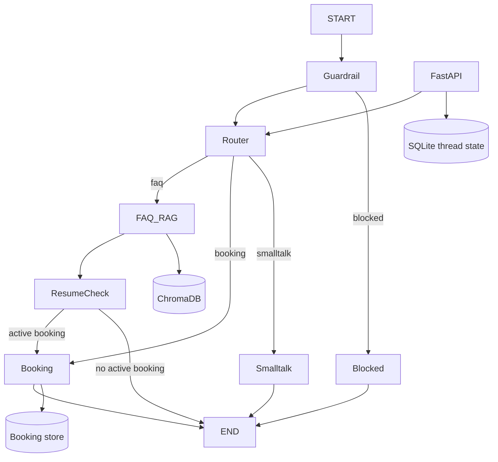

# Northwind Agentic HR Assistant

  

An autonomous, local-first HR assistant that answers Northwind handbook questions with one-indexed PDF citations and books HR 1-on-1 sessions through a persistent multi-turn workflow. It is designed to run at zero cost with deterministic fallback answers and optionally uses Groq or Gemini.

## Features
- ✅ Page-aware PDF ingestion and Chroma retrieval
- ✅ FAQ answers grounded in retrieved handbook text
- ✅ Multi-turn Performance Review, Career Discussion, and Benefits Consultation booking
- ✅ Context interleaving: FAQ detours resume an active booking
- ✅ Thread persistence in SQLite and thread isolation
- ✅ Prompt-injection guardrails and clean API errors
- ✅ React/Tailwind responsive chat, slot sidebar, local thread restore
- ✅ SSE endpoint, Docker Compose, pytest suite, and smoke test

## Demo / Screenshots
Add screenshots under `docs/screenshots/`: `rag-answer.png`, `multi-turn-booking.png`, `context-interleaving.png`, `active-node.png`, and `streaming.png`.

## Architecture walkthrough



| Node | Purpose | Inputs | Outputs/state |
|---|---|---|---|
| Guardrail | Detect injection and secret-leak requests | Latest user message | `intent=blocked`, safe response |
| Router | Classify FAQ, booking, or smalltalk | Message and booking status | `intent`, extracted booking fields |
| FAQ RAG | Retrieve relevant chunks and answer with citation | Query, handbook index | Assistant answer, `citations` |
| Resume check | Decide whether a pending booking needs continuation | `booking_active`, status | Routes to Booking or end |
| Booking | Merge fields, validate email, list/reserve slots | Booking state and message | Status, reference ID, assistant prompt |
| Smalltalk | Handle greetings and unsupported conversational turns | Message | Friendly response |
| Blocked | Finish a blocked request | Guardrail state | Safe refusal |

The state contains message history, intent, citations, active node, and a `BookingInfo` object. `booking_active` remains true while name, email, or slot is missing. FAQ processing does not clear booking fields; after the answer, the resume edge invokes Booking so the same turn can continue the workflow. The API stores serialized state by `thread_id` in SQLite, while the compiled LangGraph uses a checkpointer for graph execution. This makes refreshes, separate browser threads, and process restarts deterministic.

Request lifecycle: React sends a message to FastAPI; FastAPI loads the thread, appends the user message, invokes LangGraph, and persists the resulting state. RAG uses Chroma when a PDF has been indexed and a deterministic handbook index when no PDF or embedding model is available. Booking uses an async lock around reservations. The stream endpoint emits node, token, and done SSE events.

SQLite is used because it is free, portable, and restart-safe. Chroma is local and has metadata filters for page citations. MiniLM avoids paid embedding APIs. Structured state and explicit routing make mixed booking/FAQ messages easier to test than unconstrained agent tool calls. The current local thread store intentionally complements the LangGraph memory saver so the HTTP boundary remains restart-safe.

## Tech stack

| Layer | Technology |
|---|---|
| Backend | Python, FastAPI, Uvicorn, Pydantic v2 |
| Agent | LangGraph and LangChain |
| LLM | Groq, optional Gemini |
| Retrieval | pypdf, MiniLM, ChromaDB |
| Persistence | SQLite |
| Frontend | React, Vite, Tailwind CSS |

## Project structure

```text
agentic-hr-assistant/
├── backend/app/{api,graph,rag,tools}/
├── backend/tests/
├── frontend/src/
├── scripts/smoke_test.py
├── docs/architecture.md
├── docker-compose.yml
└── requirements.txt
```

## Local execution

Prerequisites: Python 3.10-3.13 (3.13 or earlier is recommended because native embedding wheels may not yet support 3.14), Node.js 18+, and optionally a [Groq API key](https://console.groq.com/keys).

### macOS/Linux
```bash
cd agentic-hr-assistant
cp .env.example .env
python3 -m venv .venv
source .venv/bin/activate
pip install -r requirements.txt
PYTHONPATH=backend python -m app.rag.ingest
uvicorn app.main:app --reload --app-dir backend
```

### Windows PowerShell
```powershell
cd agentic-hr-assistant
Copy-Item .env.example .env
py -3 -m venv .venv
.\.venv\Scripts\Activate.ps1
pip install -r requirements.txt
`$env:PYTHONPATH="backend"; python -m app.rag.ingest`
uvicorn app.main:app --reload --app-dir backend
```

In another terminal:
```bash
cd frontend
npm install
npm run dev -- --port 5174
```

Use port `5174` if another Vite project is already using `5173`. If you use a different frontend port, add it to `CORS_ORIGINS` in `.env` and restart the backend.

Docker:
```bash
cp .env.example .env
docker compose up --build
```

Tests and smoke test:
```bash
PYTHONPATH=backend pytest backend/tests -q
PYTHONPATH=backend python scripts/smoke_test.py
```

| Symptom | Fix |
|---|---|
| Missing API key | Leave the key empty; deterministic fallback remains available, or add `GROQ_API_KEY` to `.env`. |
| Chroma permission issue | Ensure `chroma_db/` is writable or remove it and rerun ingestion. |
| CORS error | Set `CORS_ORIGINS=http://localhost:5173`. |
| Port in use | Change Uvicorn/Vite ports or stop the existing process. |
| Rate limit | Retry after a short delay or use the deterministic path while the quota recovers. |

## API reference

`GET /api/health` returns `{"status":"ok"}`.

`GET /api/slots` returns available slot objects:
```json
[{"slot_id":"tomorrow-11","label":"Tomorrow 11:00 AM IST"}]
```

`POST /api/chat`:
```bash
curl -X POST http://localhost:8000/api/chat -H 'content-type: application/json' \
  -d '{"message":"How many PTO days do I get?"}'
```
```json
{"thread_id":"uuid","reply":"Employees receive 24 days... (Page 6)","active_node":"FAQ RAG","intent":"faq","citations":[{"page":6,"source":"..."}],"booking_status":"idle"}
```

`POST /api/chat/stream` accepts the same body and emits:
```text
event: node
data: {"node":"FAQ RAG"}

event: token
data: {"token":"Employees "}

event: done
data: {"thread_id":"uuid", "...":"..."}
```

`GET /api/threads/{thread_id}` restores `messages` and `booking`. All handlers are asynchronous.

## Verification artifacts

Run `scripts/smoke_test.py` to capture current terminal evidence:
```text
[PASS] RAG citation
[PASS] Interleaving
[PASS] Booking reference
[PASS] Guardrail
```
The same script exercises citation page 6, page 4 interleaving, a `#REV-XXXX` reference, and an injection refusal. Add screenshots under `docs/screenshots/` for the visual artifacts.

## AI engineering log

Tools used: Copilot SDK in VS Code for implementation and review; Pylance syntax diagnostics for Python validation; pytest for behavior tests; npm/Vite for the frontend build; Docker Compose for packaging.

Record only issues genuinely encountered during your run:

| What was generated | What went wrong | Diagnosis | Fix | Lesson |
|---|---|---|---|---|
| Add real development failures here | Do not invent incidents | Capture terminal output | Document the applied fix | Keep this table evidence-based |

## Testing

The tests cover page metadata, out-of-scope refusal, happy-path and taken-slot booking, prompt injection, mixed-turn interleaving, and thread isolation. Run `PYTHONPATH=backend pytest backend/tests -q`.

## Known limitations and future improvements

The deterministic fallback is intentionally small and reflects the supplied test PDF topics. For production, add a fully managed async SQLite checkpointer, authentication and authorization, durable transactional slot storage, calendar integration, rate-limit middleware, observability, and richer retrieval evaluation. The UI currently displays completed SSE responses through the standard chat route; the stream endpoint is available for a token-by-token client enhancement.

## Security notes

Secrets are read from environment variables and excluded from Git. Guardrails block common prompt injection and secret-exfiltration patterns. Handbook answers are grounded in retrieved content and out-of-scope questions produce an explicit refusal. Production deployments should add authentication, TLS, audit logging, and stricter tenant isolation.

## License and author

License: MIT (placeholder). Author: Take-home assessment candidate (placeholder).
